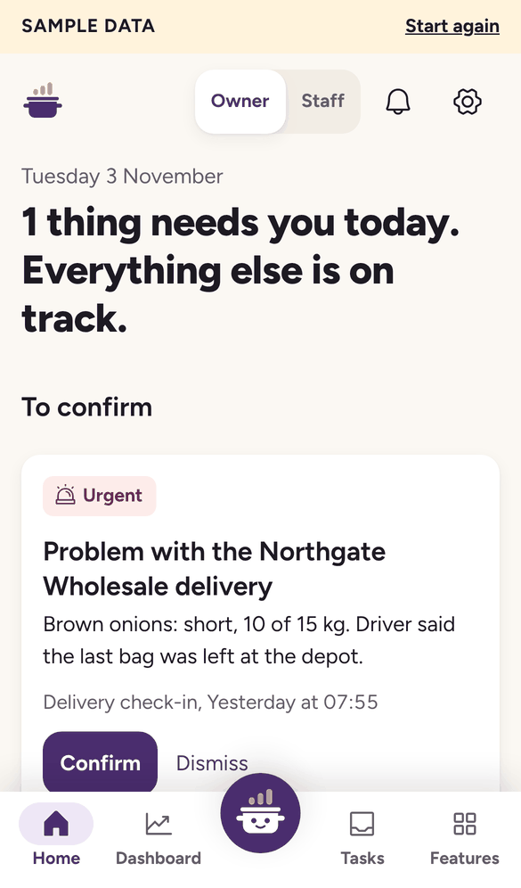
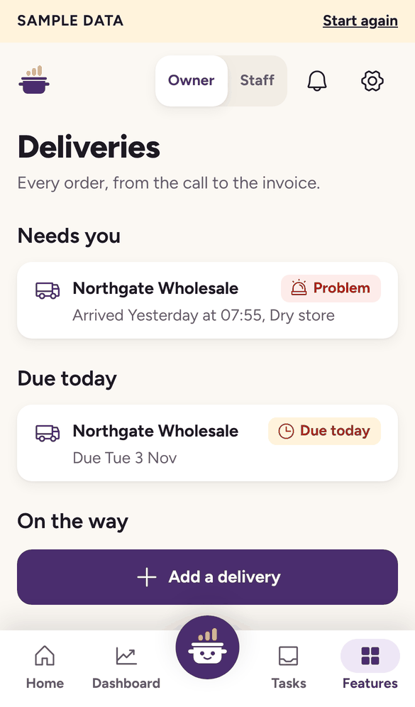
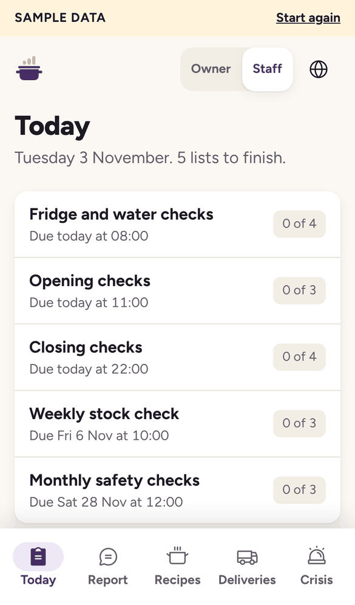
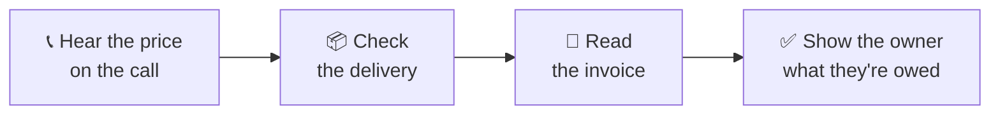

<p align="center">
  <picture>
    <source media="(prefers-color-scheme: dark)" srcset="public/brand/stockpot-logo-reversed.svg">
    
  </picture>
</p>

<p align="center"><strong>Helping small restaurants get on their feet.</strong></p>

<p align="center">
  Stockpot hears the price on a supplier call, watches the delivery and reads the invoice.<br>
  Then it shows the owner what needs fixing today, with the numbers behind it.
</p>

<p align="center">
  <a href="https://stockpot-app.vercel.app"></a>
  <a href="https://stockpot-five.vercel.app"></a>
</p>

<p align="center">
  
  
  
</p>

<p align="center"><sub>Built for the Meta Global AI Developer Hackathon 2026, Build for Your World theme.</sub></p>

## Try it

| | [Sample](https://stockpot-app.vercel.app) | [Real app](https://stockpot-five.vercel.app) |
| --- | --- | --- |
| **Best for** | A quick look | Real files and calls |
| **Data** | A made-up restaurant | Real data |
| **AI** | Simulated | Real Meta models |
| **Sign-in** | None | Passcode |

## Who it's for

Independent UK restaurant owners who run the business from their phone, and the staff who work with them.

## What it does

| | Goal | How Stockpot helps |
| --- | --- | --- |
| 🧾 | **Less manual work** | Turns receipts, spoken readings and supplier calls into rows, checklist entries and tasks |
| 💷 | **Less money lost** | Shows the last price paid during a call, then compares what was agreed, delivered and billed |
| 📈 | **More opportunities** | Traces an unusual number to its cause and suggests 3 actions |
| 🚨 | **Ready for a crisis** | Keeps crisis cards that open in two taps with no connection, and checklists with photo proof |
| 💬 | **Better communication** | Lets staff report in their own language, and the owner reads it in English |

## How one order works



## Built on Meta models

| Model | What it does in Stockpot |
| --- | --- |
| `muse-voice-transcribe-1.0` | Follows live supplier calls, labels who said what and hears staff voice reports |
| `muse-spark-1.3` | Reads invoices, menus and recipes, understands prices on calls and investigates unusual numbers |
| `sam-3.1` | Finds objects in proof photos and videos, counts deliveries on video and separates receipts in one photo |

## Why you can trust the numbers

- **Code does the maths.** Margins and amounts owed come from SQL or TypeScript, never from a model.
- **People confirm.** A voice or photo reading stays a proposal until a person saves it.
- **Every figure has a source.** A figure in the weekly summary must come from a tool result. If one doesn't, a plain summary replaces the words.
- **Nothing is sent without approval.** Stockpot drafts, and the owner approves and sends.

## Run it

You need Node 22.13 or newer.

```bash
npm ci
npm run build
npm start
```

Open http://localhost:8787. With no key, you get the sample.

To use the real models, add your key:

```bash
cp .env.example .env     # add MODEL_API_KEY
npm run check:meta       # test each model
npm start
```

## Project map

| Folder | What's inside |
| --- | --- |
| [`src`](src) | The web app that owners and staff use |
| [`server`](server) | Routes, Meta model calls, money checks and the database |
| [`api`](api) | The entry point Vercel uses to run the server |
| [`shared`](shared) | Code used by both sides, and translations for 18 languages |
| [`public`](public) | Logos, fonts and sample files |
| [`scripts`](scripts) | Model checks, sample data and test tools |
| [`test`](test) | Automated tests |
| [`docs`](docs) | The full documentation |

## Tested so far

- ✅ 238 automated tests
- ✅ 13 of 13 real Meta model checks
- ✅ 22 of 22 sample files read correctly by real Muse Spark
- ✅ Real deployment on Vercel and Supabase
- ⏳ Not yet measured: real speakerphone audio, kitchen noise and accuracy on real deliveries
- ⏳ Only tested against stand-ins: WhatsApp, Twilio and Gmail

## Known limits

- One restaurant only, with passcode sign-in instead of individual accounts.
- Food cost doesn't include labour, so this isn't a full P&L.
- Crisis cards, temperature ranges and translations need a qualified review before real use.
- Recording law and the privacy notice need review before real use.

[See all known limits](docs/testing-and-limits.md#known-limits).

## Read more

| Guide | What's in it |
| --- | --- |
| [Features](docs/features.md) | A day in the restaurant, setup, WhatsApp and phones |
| [How it works](docs/how-it-works.md) | Every model step, the safety rules and the architecture |
| [Deploy](docs/deploy.md) | Where data lives, and how to host it on Vercel and Supabase |
| [Testing and limits](docs/testing-and-limits.md) | How it was tested, and what it can't do yet |

## Credits

Everything in this repository was written during the event, with Claude. Reused parts are the open-source packages in [`package.json`](package.json), the Stockpot brand files, the Figtree font, Phosphor icons, and the MIT-licensed [Stageshow](https://benji.org/stageshow) kit, used only for the welcome page demos.
