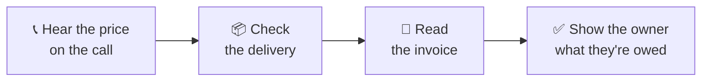
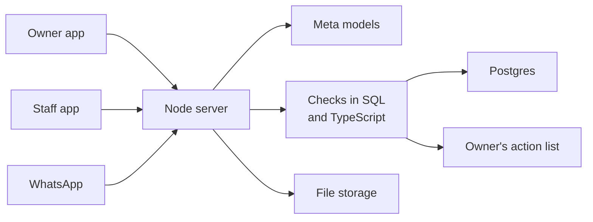

<p align="center">
  <picture>
    <source media="(prefers-color-scheme: dark)" srcset="public/brand/stockpot-logo-reversed.svg">
    
  </picture>
</p>

<p align="center"><strong>Helping small restaurants get on their feet.</strong></p>

<p align="center">
  <a href="https://stockpot-app.vercel.app">Sample site</a>
  &nbsp;·&nbsp;
  <a href="https://stockpot-five.vercel.app">Real app</a>
  &nbsp;·&nbsp;
  <a href="docs/features.md">Docs</a>
</p>

<p align="center"><sub>Built for the Meta Global AI Developer Hackathon 2026, Build for Your World theme.</sub></p>

## Who it's for

Stockpot is for independent restaurant and café owners who are too busy to check everything themselves.

Prices change on the phone, deliveries arrive short and invoices don't always match. Stockpot checks all of it, then shows the owner what needs attention today, with the numbers behind it.

## How one order works



## Features

### For owners

| Feature | What it does |
| --- | --- |
| **Supplier calls** | Shows the last price paid during a call, then writes the summary, draft order and tasks |
| **Deliveries** | Shows what was agreed, delivered and billed for each line, and counts boxes on video, with boxes drawn live over the camera |
| **Receipts and invoices** | Turns photos and PDFs into rows, checks the printed sums and flags anything unsure |
| **Price check** | Finds price rises and possible double billing from old invoices |
| **Menu and margins** | Reads recipes, costs each dish and shows the menu price that hits your target margin |
| **File import** | Reads sales, recipes and price lists from CSV, Excel, PDF, Word, text and photos |
| **Analyst** | Traces an unusual number to its cause, suggests 3 actions and answers questions |
| **What to say** | Prepares the owner for a hard call with the opening, the facts and the ask |

### For staff

| Feature | What it does |
| --- | --- |
| **Checklists** | Logs checks by voice, photo or video, with deadlines and WhatsApp reminders |
| **Reports** | Lets staff report in their own language, and the owner reads it in English |
| **Crisis cards** | Opens the right steps in two taps, even with no connection |
| **Recipes** | Shows ingredients, steps and timings, and never shows costs |
| **Deliveries** | Records what arrived, where it went and what went wrong |

The app works in 18 languages. [See every feature](docs/features.md).

## Technical implementation

### Stack

| Layer | Technology |
| --- | --- |
| **Web app** | React 19, TypeScript, Vite and a service worker for offline crisis cards |
| **Server** | Node 22, Express 5 and WebSockets |
| **AI** | Meta Model API: Muse Spark, Muse Voice Transcribe and SAM 3.1 |
| **Data** | Postgres and private file storage on Supabase, with SQLite for local use |
| **Hosting** | Vercel Functions in Frankfurt, with Supabase Cron running timed work every minute |

### Architecture

Every AI call goes through the server, so the Meta key never reaches a device.



### Meta models

| Model | How Stockpot uses it |
| --- | --- |
| `muse-voice-transcribe-1.0` | Streams live calls, labels who said what after the call and transcribes staff voice reports |
| `muse-spark-1.3` | Reads documents through JSON schemas, tells a new price from a remembered one and runs the analyst with function tools |
| `sam-3.1` | Finds objects in proof photos, tracks them through video and separates receipts in one photo |

### Live call flow

1. The browser streams microphone audio to the server over a WebSocket.
2. The server passes it to Muse Voice Transcribe in real time.
3. A quick check reads each partial transcript, so a clear price appears before the sentence ends.
4. Muse Spark settles anything less clear at the end of the turn.
5. After the call, Muse Voice Transcribe labels the speakers, and Muse Spark drafts the order.
6. Each order line must point to the words that prove it.
7. The browser moves to a new socket every 4 minutes, because Vercel closes a socket at about 300 seconds.

### How the numbers stay correct

- **Code does the maths.** SQL views and TypeScript work out margins and amounts owed, never a model.
- **Model output is checked.** Muse Spark answers through a JSON schema, and the server validates every answer with Ajv.
- **The analyst can only read.** Its function tools can't change data or contact anyone.
- **People confirm.** A voice or photo reading stays a proposal until a person saves it.
- **Data stays private.** Files sit in a private bucket, and row level security is on for every table.

[Read the full technical guide](docs/how-it-works.md).

## Project structure

```text
stockpot/
├── api/                  Vercel entry point
├── docs/                 Full documentation
├── public/               Logos, fonts and sample files
├── scripts/              Model checks, sample data and test tools
├── server/
│   ├── ai/               Meta models, prompts and the analyst
│   ├── core/             Settings, sign-in, database, files and timers
│   ├── integrations/     WhatsApp, Gmail and phone
│   ├── money/            Pricing, margins, sales and proof
│   ├── operations/       Calls, deliveries, checklists, crisis cards and tasks
│   ├── sample/           Stand-in for the Meta API
│   ├── setup/            Onboarding, file import and documents
│   ├── app.ts            Routes
│   └── index.ts          Server start
├── shared/               Costing code and translations
├── src/
│   ├── components/       Shared interface parts
│   ├── demo/             Welcome page stories
│   ├── kit/              Stageshow animation kit
│   ├── lib/              Browser helpers
│   ├── screens/          App screens
│   ├── App.tsx           Navigation
│   └── main.tsx          App start
└── test/                 Automated tests
```

## Run it

You need Node 22.13 or newer.

```bash
npm ci
npm run build
npm start
```

Open http://localhost:8787. With no key, you get the sample.

To use the real models, add your key:

```bash
cp .env.example .env     # add MODEL_API_KEY
npm run check:meta       # test each model
npm start
```

## Testing

- ✅ 246 automated tests
- ✅ 13 of 13 real Meta model checks
- ✅ 22 of 22 sample files read correctly by real Muse Spark
- ✅ Real deployment on Vercel and Supabase

## Read more

| Guide | What's in it |
| --- | --- |
| [Features](docs/features.md) | A day in the restaurant, setup, WhatsApp and phones |
| [How it works](docs/how-it-works.md) | Every model step, the safety rules and the architecture |
| [Deploy](docs/deploy.md) | Where data lives, and how to host it on Vercel and Supabase |
| [Testing](docs/testing.md) | How it was tested, and how to repeat it |
